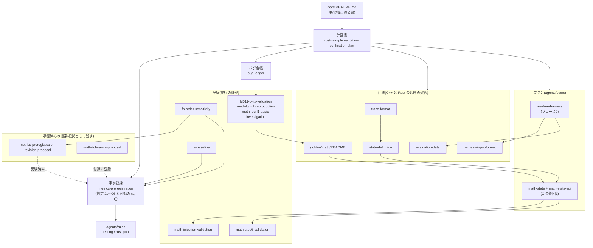

# 現在地と文書の地図

人がこのプロジェクトの進み具合と文書の関係を見るための入口。**進捗と次の作業の正本はこの文書だけ**に置く。計画書・プラン・記録は、自分の中身の状態(草案/承認済み/完了)だけを持ち、全体の進捗は書かない。

最終更新: 2026-11-01(B に BL-001 の修正 `d8290e9` を加えた時点)

目的・比較の定義(A→B→C→D)・判定の方針は[計画書](rust-reimplementation-verification-plan.md)、作業の手順とコマンドは [AGENTS.md](../AGENTS.md)(CLAUDE.md と同じファイル)。

## 1. いまどこか

### 系統ごと

| 系統 | 状態 | 詳細 |
| --- | --- | --- |
| A(現状の C++) | 確定。タグ `A-v1`(`3dc49bc`) | [a-baseline.md](a-baseline.md) |
| B(修正した C++) | 作成中。タグなし | 修正と決定は[台帳](bug-ledger.md) |
| C(Rust) | 作成中 | 下の範囲の表 |
| D(改良した Rust) | 未着手(C の完成後) | — |

### 移植の範囲ごと(計画書 §6 の5条件)

範囲の状態はこの表だけに書く。範囲は移す順。条件は 1 定義の文書 / 2 台帳 / 3 L1・L2 の試験 / 4 再現性 / 5 注入による確認。「—」は、この範囲について条件を満たしたかを誰も判断・記録していないもの。

| 範囲 | 1 | 2 | 3 | 4 | 5 | 移植 |
| --- | --- | --- | --- | --- | --- | --- |
| 数学と状態の表現 | 済 | 済 | 済 | 済 | 済 | 完了([math-state.md](../agents/plans/math-state.md)) |
| 前処理 | 済 | — | 未(トレース・L1・ゴールデン出力) | — | 未((a, r) 未登録) | 未着手 |
| iVox | — | — | 未 | — | 未 | 未着手 |
| 推定器 | — | — | 未 | — | 未 | 未着手 |
| イベントループ | — | — | 未 | — | 未 | 未着手 |

前処理の条件1は[状態の定義](state-definition.md)のモードの節を使う見込み。条件2は、関わる修正(前処理は BL-007、iVox は BL-010・BL-012)は済んだが、関わる仮説の扱いを含めて満たしたかは未判断。トレースの仕様の状態は [trace-format.md](trace-format.md) の状態行を見る。

### ゲート

出来事を起点に開き、人が判定する。手順は5節。記録は docs/gates/ に1ゲート1ファイルで置き、判定の後は書き換えない。

| ゲート | 開くきっかけ | 判定の基準(計画書) | 記録 |
| --- | --- | --- | --- |
| 範囲の着手 | 範囲のプランを作る前 | §6 の5条件 | 数学と状態の表現はゲート導入前に通過扱い(プランの承認) |
| 範囲の完了 | 範囲のプランの手順をすべて終えたとき | フェーズ3の完了条件(範囲ごと) | 数学と状態の表現はゲート導入前に通過扱い(プランの完了) |
| フェーズ0の終了 | 完了条件が揃ったとき | フェーズ0の完了条件 | [2026-11-01(判定待ち)](gates/2026-11-01-phase0-exit-phase1-cutoff.md) |
| フェーズ1の打ち切り | 計画書の手段の表を一通り実行したとき | フェーズ1の終了条件・完了条件 | 同上 |
| B のタグ | 全範囲でフェーズ2の完了条件が揃ったとき | フェーズ2の完了条件(全範囲) | — |
| C の完成 | 全範囲の完了ゲートを通ったとき。通ると最終評価用のデータの封印を解く | §6 の C の完成点 | — |
| フェーズ4・5の完了 | 報告がそろったとき | 各フェーズの完了条件 | — |

### 完了条件のチェックリスト

フェーズの状態はこのリストだけに書く。範囲ごとの条件は上の範囲の表で見る。チェックを入れるのは、根拠(コミットか記録)を書いたときだけ(検査 D6)。

**フェーズ0**

- [x] §6 の条件4(A について): タグ、イメージの固定、`docker/packages.lock`、`tests/harness/venv.lock`、メタデータの拡張(`5c56e25`・`01673bd`・`440262c`)。既知の例外は Livox-SDK の版が固定されていないこと
- [x] §6 の条件1: [state-definition.md](state-definition.md)(`ce641f4`)
- [ ] §5 のトレースの完了条件3つ
- [ ] ハーネスの判定(T1〜T14)の条件5: T1・T3・T4・T11・T13 は注入の記録がない(T9 は計測で、合否にしない)
- [ ] 完了条件の外: ハーネスの差分の別セッションレビュー、入力の生成器、性能の計測、サニタイザでの実行

**フェーズ1**(台帳27件(分類済み9・仮説18))

- [ ] 台帳のすべての項目に状態と分類がある
- [x] 再現済みのものに決定が記録されている([bug-ledger.md](bug-ledger.md))
- [ ] 終了条件: 計画書の手段の表を一通り実行した
  - [ ] ASan/UBSan/MSan で開発用データを実行(ASan+UBSan はビルドの成立だけ確認)
  - [ ] TSan
  - [ ] clang-tidy / cppcheck
  - [x] 手動 + LLM レビュー(`13bf9ae`・`b4d22ca`・`aaf3b69`)
  - [ ] 摂動テスト(入力の生成器が前提)

**フェーズ2・3**(範囲ごとの条件は範囲の表)

- [ ] B についての条件4: B のタグ
- [ ] C の完成点(§6)

**フェーズ4・5**

- [ ] A・B・C の3層と性能・安全性、開発用と最終評価用のデータ
- [ ] D の L1・L3・性能・安全性

## 2. 次の作業

上から順に優先。状態は1節を見る。

1. 前処理の範囲の表で「未」の条件を揃える: [トレースの仕様](trace-format.md)(v6 で承認済み)の B での実装(実行の手順で `OMP_NUM_THREADS=1` を設定する。今の `eval/run_offline.sh` は既定で渡さない)、前処理の L1 テストとゴールデン出力、(a, r) の登録(人の承認が要る)と注入による確認。揃ったら[ひな形](../agents/plans/template.md)から前処理のプランを作る
2. ハーネスの差分の別セッションレビュー([ros-free-harness.md](../agents/plans/ros-free-harness.md) の手順6)
3. 性能の計測の仕組み。A の性能と RPE 1 s を測る
4. 入力の生成器(合成・摂動・ファズ)と、サニタイザ・TSan での実行
5. 台帳: BL-002・BL-006 の再現の試み
6. 数学と状態の表現から持ち越した未検証の事項(急がない。一覧は [math-state.md](../agents/plans/math-state.md) の完了時の記録)

### 人の判断を待っているもの

一覧だけを置く。中身は各リンク先にある。

- 前処理の (a, r) の登録
- 台帳の仮説の分類と決定([bug-ledger.md](bug-ledger.md))
- [2026-11-01 のゲート](gates/2026-11-01-phase0-exit-phase1-cutoff.md)の5節で未判定のもの

## 3. 文書の地図

### 関係

矢印は「上の文書が下の文書を決める・下の文書が上の文書の根拠になる」の向き。

### 一覧

種類ごとの読み方:

- **正本**: 方針と判定を決める。変えるには人の承認が要る
- **仕様**: C++ と Rust が従う形式・定義
- **プラン**: 1つの作業の設計と実施記録
- **記録**: ある日に何を実行し何が出たかの証拠。後から書き換えない
- **履歴**: 承認済みで正本に反映した提案。理由を辿るために残す

| 文書 | 種類 | 何のために読むか |
| --- | --- | --- |
| [rust-reimplementation-verification-plan.md](rust-reimplementation-verification-plan.md) | 正本 | 目的、比較の定義、評価の3層、§6 の移植を始める条件、フェーズ、決定事項 |
| [metrics-preregistration.md](metrics-preregistration.md) | 正本 | B→C の合否(J1〜J6)と範囲ごとの (a, r) |
| [bug-ledger.md](bug-ledger.md) | 正本 | B に入れる修正と、その決定 |
| [evaluation-data.md](evaluation-data.md) | 仕様 | 評価 bag・入力ファイルの SHA256、封印した最終評価用データ |
| [harness-input-format.md](harness-input-format.md) | 仕様 | 入力ファイル(PLIN)の形式 |
| [state-definition.md](state-definition.md) | 仕様 | 状態・誤差状態・座標系・単位(§6 の条件1) |
| [trace-format.md](trace-format.md) | 仕様 | 段階ごとの記録の形式(前処理から後の L2) |
| [golden/math/README.md](../golden/math/README.md) | 仕様 | 数学のゴールデン出力の形式・出所・更新の規則 |
| [ros-free-harness.md](../agents/plans/ros-free-harness.md) | プラン | `pointlio_offline` とハーネスのテスト T1〜T14 |
| [math-state.md](../agents/plans/math-state.md) | プラン | C の最初の範囲の設計と手順1〜8の記録 |
| [math-state-api.md](../agents/plans/math-state-api.md) | プラン | 上の範囲の Rust の公開 API |
| [template.md](../agents/plans/template.md) | ひな形 | 新しいプランを作るとき |
| [a-baseline.md](a-baseline.md) | 記録 | A の演算順の変種 V0〜V4 の幅と精度 |
| [fp-order-sensitivity.md](fp-order-sensitivity.md) | 記録 | ビルドフラグだけで軌跡がずれること(判定を J1〜J6 に変えた理由) |
| [math-injection-validation.md](math-injection-validation.md) | 記録 | 数学の照合器が誤りを検出できること(条件5) |
| [math-step6-validation.md](math-step6-validation.md) | 記録 | C の数学の範囲の検証(debug/release、libm、逆アセンブル) |
| [math-log-l1-reproduction.md](math-log-l1-reproduction.md) | 記録 | BL-011 の発見(B も L1 を満たさない入力) |
| [math-log-l1-basis-investigation.md](math-log-l1-basis-investigation.md) | 記録 | BL-011 の L1 の基準の根拠の調査 |
| [bl011-b-fix-validation.md](bl011-b-fix-validation.md) | 記録 | BL-011 の B での修正と検証 |
| [metrics-preregistration-revision-proposal.md](metrics-preregistration-revision-proposal.md) | 履歴 | J1〜J6 に組み替えた理由 |
| [math-tolerance-proposal.md](math-tolerance-proposal.md) | 履歴 | 数学の範囲の (a, r) の導出 |
| [gates/template.md](gates/template.md) | ひな形 | ゲートの記録を作るとき |
| [gates/2026-11-01-phase0-exit-phase1-cutoff.md](gates/2026-11-01-phase0-exit-phase1-cutoff.md) | 記録(ゲート) | フェーズ0の終了とフェーズ1の打ち切りの判断材料 |
| [agents/README.md](../agents/README.md)、[testing.md](../agents/rules/testing.md)、[rust-port.md](../agents/rules/rust-port.md) | ルール | 作業するときの規則(主にエージェント向け) |
| [codex-handoff.md](../agents/codex-handoff.md)、[brief-template.md](../agents/handoff/brief-template.md) | ルール、ひな形 | Claude Code がプランとレビュー、Codex が実装を担当するときの手順と指示書(移植と B のバグ修正) |

リポジトリ直下の README.md と Log/guide.md は上流(hku-mars/Point-LIO)のもので、このプロジェクトの文書ではない。

## 4. 主な節目とコミット

コミットは細かく、文書の改訂だけのものが多い。節目に当たるものだけを挙げる。

| 日付 | 節目 | コミット・タグ |
| --- | --- | --- |
| 2026-10-21 | 計画書、事前登録の初版、評価データの固定、Docker 環境 | `d4d4718`・`f85e5bd`・`d6d7a6d`・`1608426` |
| 2026-10-24〜26 | ROS 非依存のハーネス(`pointlio_offline`、T1〜T14) | `add3cf1`〜`69441d5`。タグ `A-v1` = `3dc49bc` |
| 2026-10-26 | 環境の固定、台帳の開始、判定を J1〜J6 に改訂、状態の定義、数学の L1 とゴールデン出力、A のベースライン | `5c56e25`・`c8b197a`・`42d2bb4`・`46e9769`・`b2ca192`・`06f2c08`・`a5740d2` |
| 2026-10-30 | B: BL-008・009・010 を修正。数学の (a, r) を登録 | `10f0931`・`aa219a5`・`fff663e`・`efc461e` |
| 2026-10-31 | 照合器と注入による確認。数学のプランを承認。B: BL-011 を修正してゴールデン出力を再生成。C: 数学を実装 | `0ed3d08`・`b1ba605`・`4558dea`・`88b1c83`・`30e5d51` |
| 2026-11-01 | C: 数学の範囲を完了。B: BL-007・BL-012・BL-001 を修正。トレースの仕様を v1→v5 に改訂 | `a5e458d`・`80d49a1`・`86911cb`・`e7da791`・`d8290e9` |

## 5. 更新・点検・ゲートの手順

### 1つの事実は1か所に書く

ほかの場所にはリンクだけを置き、同じ事実を写さない。写すと、元を直したときに写しが古くなる。

| 事実 | 書く場所 |
| --- | --- |
| 範囲ごとの状態 | 1節の範囲の表 |
| フェーズの状態 | 1節のチェックリスト |
| 各文書の状態(草案・承認済み・版) | その文書の状態行 |
| バグの内容と決定 | 台帳 |
| 方針の決定 | 計画書の決定事項 |
| ゲートの判定 | ゲート記録の8節(方針を変える判定は、中身を計画書の決定事項に書き、8節からリンクする) |
| 範囲の実施記録・未検証の範囲 | その範囲のプラン |

ゲート記録は判定の時点の写しで、判定の後は書き換えないので、写しを含んでよい。

以前の進捗の詳細(フェーズ0の各項目の記録など)は、`3d68736` の docs/README.md の付録にある。

### 日々の更新

- 範囲の条件・系統・フェーズの状態が変わる作業を終えたら、同じコミットでこの文書の1〜2節と「最終更新」を直す。進捗の更新だけのコミットは作らない
- 新しい文書を足したら、3節の一覧に種類と読む目的を足す(状態は書かない)。関係が変わるなら図も直す
- 節目に当たるコミットをしたら4節に足す
- 文書を変えたコミットの前に、検査スクリプトを走らせる(下)

### 検査スクリプト

`python3 -B tests/docs/check_docs.py`(リポジトリ直下、ホストの `python3`)。終了0で指摘なし、1で指摘あり。検査の契約テストは `python3 -B tests/docs/test_check_docs.py`(各検査を誤りの注入で落とす)。

| 検査 | 内容 |
| --- | --- |
| D1 | 相対リンクの先のファイルが存在する(見出しへのアンカーは見ない) |
| D2 | バッククォートで囲んだ16進の語が、このリポジトリのコミットである(ROS の md5 と、スクリプトに列挙した外部のハッシュを除く) |
| D3 | docs/・agents/・golden/ の文書が、すべてこの文書からリンクされている |
| D4 | この文書の「台帳N件(…)」が台帳の件数・状態と合う |
| D5 | 事前登録の状態行の改訂回数が、改訂履歴と合う |
| D6 | チェックの入った項目に、根拠(コミットか文書へのリンク)がある |

内容が正しいか(実績どおりか、見通しが妥当か)は検査しない。そこはゲートで人が見る。

### ゲートの手順

1. [ひな形](gates/template.md)をコピーし、`docs/gates/<日付>-<ゲート名>.md` として下書きする
2. 検査スクリプトの結果を貼る
3. 判定の基準(計画書の完了条件・終了条件)を1つずつ、根拠つきで「満たす/満たさない/判断が要る」に分ける
4. 実績(前回のゲートから終わったもの)、見通し(残り・リスク。開始日・期限・期間の目安は管理しない)、判断待ちの一覧、台帳の滞留(仮説のままの日数)、持ち越した未検証事項を書く
5. 文脈を持たない subagent(別セッション)に、下書きと関係する文書だけを渡してレビューさせ、指摘と対応を記録に残す
6. 人が判定し、判定と日付を記録に書く。この文書の1節(ゲートの表とチェックリスト)を同じコミットで直す

### 軽い点検

ゲートが7日開かなかったときに行う。記録は作らず、指摘があればこの文書か台帳を直す。

- 検査スクリプトを走らせる
- 2節の「人の判断を待っているもの」と、台帳の仮説の滞留を見直す
- 最終更新の日付が7日より古ければ、1節を実態に合わせる
