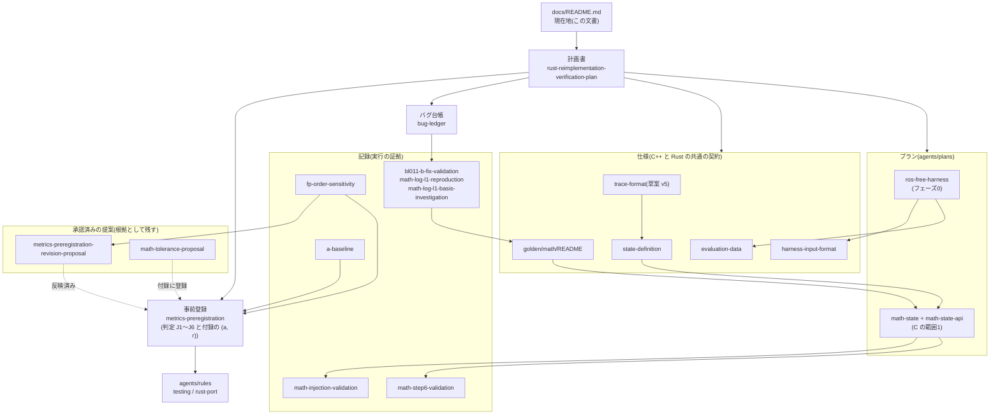

# 現在地と文書の地図

人がこのプロジェクトの進み具合と文書の関係を見るための入口。**進捗と次の作業の正本はこの文書だけ**に置く。計画書・プラン・記録は、自分の中身の状態(草案/承認済み/完了)だけを持ち、全体の進捗は書かない。

最終更新: 2026-11-01(`dev` の `70f593d` に、ゲートと検査スクリプトの導入を加えた時点)

目的・比較の定義(A→B→C→D)・判定の方針は[計画書](rust-reimplementation-verification-plan.md)、作業の手順とコマンドは [AGENTS.md](../AGENTS.md)(CLAUDE.md と同じファイル)。

## 1. いまどこか

### 系統ごと

| 系統 | 状態 | 根拠 |
| --- | --- | --- |
| A(現状の C++) | 確定。タグ `A-v1`(`3dc49bc`)。ベースラインを測定済み(性能と RPE 1 s は未測定) | [a-baseline.md](a-baseline.md) |
| B(修正した C++) | 作成中。6件を修正済み(BL-007〜012)。BL-001 は「直す」と決まったが未修正。タグなし | [bug-ledger.md](bug-ledger.md) |
| C(Rust) | 5範囲のうち「数学と状態の表現」だけ完了(`rust/pointlio-math`) | [math-state.md](../agents/plans/math-state.md) |
| D(改良した Rust) | 未着手(C の完成後) | — |

### 移植の範囲ごと(計画書 §6 の5条件)

範囲は移す順。条件は 1 定義の文書 / 2 台帳 / 3 L1・L2 の試験 / 4 再現性 / 5 注入による確認。

| 範囲 | 1 | 2 | 3 | 4 | 5 | 移植 |
| --- | --- | --- | --- | --- | --- | --- |
| 数学と状態の表現 | 済 | 済 | 済 | 済 | 済 | **完了**(2026-11-01) |
| 前処理 | 済 | BL-007 修正済み | 未(トレース仕様は草案 v5・未レビュー・未実装。L1・ゴールデン出力なし) | — | 未((a, r) 未登録) | 未着手 |
| iVox | — | BL-010・BL-012 修正済み | 未 | — | 未 | 未着手 |
| 推定器 | — | — | 未 | — | 未 | 未着手 |
| イベントループ | — | — | 未 | — | 未 | 未着手 |

「—」は、この範囲について条件を満たしたかを誰も判断・記録していないもの。前処理の条件1は[状態の定義](state-definition.md)のモードの節を使う見込みで、下の「次の作業」でも残りの条件に挙げていない。

### フェーズごと

| フェーズ | 状態 | 残り |
| --- | --- | --- |
| 0 土台づくり | 項目1〜5は完了。項目6は一部 | ハーネスの差分の別セッションレビュー、トレースのレビューと実装、入力生成器、性能の計測、サニタイザでの実行 |
| 1 バグ調査 | 進行中。台帳24件(分類済み9・仮説15) | 仮説 BL-013〜024 の再現・分類。BL-002(TSan)・BL-006 の再現の試み。サニタイザでの実行は未着手 |
| 2 B の作成 | 進行中。数学と状態の表現の範囲は L1・L2 済み | BL-001 の修正。前処理から後の範囲の L1・L2。B のタグ |
| 3 C の実装 | 進行中。1/5 範囲 | 前処理から後の4範囲 |
| 4 比較と報告 | 未着手 | — |
| 5 D | 未着手 | — |

各フェーズの詳細な進捗は末尾の付録と、各プランの実施記録。

### ゲート

出来事を起点に開き、人が判定する。手順は5節。記録は [docs/gates/](gates/template.md) に1ゲート1ファイルで置き、判定の後は書き換えない。

| ゲート | 開くきっかけ | 判定の基準(計画書) | 状態 |
| --- | --- | --- | --- |
| 範囲の着手 | 範囲のプランを作る前 | §6 の5条件 | 数学と状態の表現: 通過扱い(ゲート導入前。[math-state.md](../agents/plans/math-state.md) の承認、2026-10-31)。前処理: 未 |
| 範囲の完了 | 範囲のプランの手順をすべて終えたとき | フェーズ3の完了条件(範囲ごと) | 数学と状態の表現: 通過扱い(ゲート導入前。同プランの完了、2026-11-01) |
| フェーズ0の終了 | 完了条件が揃ったとき | フェーズ0の完了条件 | **判定待ち**。きっかけの前に、導入後の最初の点検として前倒しで開いた([2026-11-01 の記録](gates/2026-11-01-phase0-exit-phase1-cutoff.md)) |
| フェーズ1の打ち切り | 計画書の手段の表を一通り実行したとき | フェーズ1の終了条件・完了条件 | **判定待ち**。前倒しで開いた(同上) |
| B のタグ | 全範囲でフェーズ2の完了条件が揃ったとき | フェーズ2の完了条件(全範囲) | 未 |
| C の完成 | 全範囲の完了ゲートを通ったとき。通ると最終評価用のデータの封印を解く | §6 の C の完成点 | 未 |
| フェーズ4・5の完了 | 報告がそろったとき | 各フェーズの完了条件 | 未 |

ゲートが7日開かなかったときは、軽い点検をする(5節)。

### 完了条件のチェックリスト

チェックを入れるのは、根拠(コミットか記録)を書いたときだけ。根拠のないチェックは検査スクリプト(D6)が落とす。

**フェーズ0**

- [x] §6 の条件4(A について): タグ `A-v1`、イメージの固定、`docker/packages.lock`、`tests/harness/venv.lock`、メタデータの拡張(`5c56e25`・`01673bd`・`440262c`)。既知の例外は Livox-SDK の版が固定されていないこと
- [x] §6 の条件1: [state-definition.md](state-definition.md)(`ce641f4`)
- [ ] §5 のトレースの完了条件3つ: 仕様は草案 v5、実装なし
- [ ] ハーネスの判定(T1〜T14)の条件5: T2・T5〜T8・T10・T12・T14 は確認済み。T1・T3・T4・T11・T13 は記録なし(T9 は計測で、合否にしない)
- [ ] 完了条件の外: ハーネスの差分の別セッションレビュー

**フェーズ1**

- [ ] 台帳のすべての項目に状態と分類がある: 仮説15件の分類は案のまま
- [x] 再現済みのものに決定が記録されている: 再現した9件すべてに決定がある([bug-ledger.md](bug-ledger.md))
- [ ] 終了条件: 計画書の手段の表を一通り実行した
  - [ ] ASan/UBSan/MSan で開発用データを実行: ASan+UBSan はビルドの成立だけ確認。MSan は未試行
  - [ ] TSan: 未実行(BL-002 の再現の試み)
  - [ ] clang-tidy / cppcheck: 未実行
  - [x] 手動 + LLM レビュー: トレースの仕様のレビューなどで BL-012〜024 を起票(`13bf9ae`・`b4d22ca`・`aaf3b69`)
  - [ ] 摂動テスト: 入力の生成器(フェーズ0の項目6)が未着手

**フェーズ2(範囲ごと: 条件2・3・5、B についての条件4)**

- [x] 数学と状態の表現: 条件2・3・5([math-state.md](../agents/plans/math-state.md) の背景)
- [ ] B についての条件4: イメージは固定済み、B のタグなし
- [ ] 前処理・iVox・推定器・イベントループ

**フェーズ3(範囲ごと: L2 を通り L1 を満たす)**

- [x] 数学と状態の表現: L1 15件・L2 13部品が通過([math-step6-validation.md](math-step6-validation.md)、`a5e458d`)
- [ ] 前処理・iVox・推定器・イベントループ
- [ ] C の完成点(§6)

**フェーズ4・5**

- [ ] A・B・C の3層と性能・安全性、開発用と最終評価用のデータ
- [ ] D の L1・L3・性能・安全性

## 2. 次の作業

上から順に優先。

1. 前処理の範囲の、§6 の条件を揃える
   - 条件3: トレースの仕様([trace-format.md](trace-format.md)、草案 v5)をレビューして実装する。前処理の L1 テストとゴールデン出力を作る
   - 条件5: 前処理の (a, r) を事前登録の付録に登録し(人の承認が要る)、注入で確かめる
   - 揃ったら、[ひな形](../agents/plans/template.md)から前処理のプランを作る
2. ハーネスの差分の別セッションレビュー([ros-free-harness.md](../agents/plans/ros-free-harness.md) の手順6、未実施)
3. 性能の計測の仕組み(フェーズ0の項目6)。A の性能と RPE 1 s を測る
4. フェーズ0の残り: 合成・摂動・ファズの入力の生成器、サニタイザでの実行
5. 台帳: BL-002・BL-006 の再現の試み、BL-001 の B での修正
6. 数学と状態の表現から持ち越した未検証の事項(急がない): f32 の中間計算での累積と分岐の変化、`predict` の `Matrix3d × Block<3,1>` の演算順。Livox-SDK の版が固定されていないこと(既知の問題、AGENTS.md の「ビルド(C++)」)

### 人の判断を待っているもの

- トレースの仕様 v5 の別セッションレビュー(v5 の修正は作成者の確認だけ)
- 前処理の (a, r) の登録
- 仮説 BL-013〜024 の分類と決定
- [2026-11-01 のゲート](gates/2026-11-01-phase0-exit-phase1-cutoff.md)の5節の残り4件: フェーズ0の終了、打ち切りのときに再現できなかった仮説の閉じ方、事前登録の状態行、BL-007・BL-012 の証拠欄

## 3. 文書の地図

### 関係

矢印は「上の文書が下の文書を決める・下の文書が上の文書の根拠になる」の向き。

### 一覧

種類ごとの読み方:

- **正本**: 方針と判定を決める。変えるには人の承認が要る
- **仕様**: C++ と Rust が従う形式・定義
- **プラン**: 1つの作業の設計と実施記録
- **記録**: ある日に何を実行し何が出たかの証拠。後から書き換えない
- **履歴**: 承認済みで正本に反映した提案。理由を辿るために残す

| 文書 | 種類 | 状態 | 何のために読むか |
| --- | --- | --- | --- |
| [rust-reimplementation-verification-plan.md](rust-reimplementation-verification-plan.md) | 正本 | 第2版、承認済み | 目的、比較の定義、評価の3層、§6 の移植を始める条件、フェーズ、決定事項 |
| [metrics-preregistration.md](metrics-preregistration.md) | 正本 | 承認済み、5回改訂(最新 2026-11-01) | B→C の合否(J1〜J6)と範囲ごとの (a, r) |
| [bug-ledger.md](bug-ledger.md) | 正本 | 24件 | B に入れる修正と、その決定 |
| [evaluation-data.md](evaluation-data.md) | 仕様 | 確定 | 評価 bag・入力ファイルの SHA256、封印した最終評価用データ |
| [harness-input-format.md](harness-input-format.md) | 仕様 | v1 確定 | 入力ファイル(PLIN)の形式 |
| [state-definition.md](state-definition.md) | 仕様 | レビュー反映済み | 状態・誤差状態・座標系・単位(§6 の条件1) |
| [trace-format.md](trace-format.md) | 仕様 | 草案 v5、v5 は未レビュー、実装なし | 段階ごとの記録の形式(前処理から後の L2) |
| [golden/math/README.md](../golden/math/README.md) | 仕様 | BL-011 後に再生成 | 数学のゴールデン出力の形式・出所・更新の規則 |
| [ros-free-harness.md](../agents/plans/ros-free-harness.md) | プラン | 手順0〜5 完了、手順6(レビュー)未実施 | `pointlio_offline` とハーネスのテスト T1〜T14 |
| [math-state.md](../agents/plans/math-state.md) | プラン | 完了 | C の最初の範囲の設計と手順1〜8の記録 |
| [math-state-api.md](../agents/plans/math-state-api.md) | プラン | 承認済み | 上の範囲の Rust の公開 API |
| [template.md](../agents/plans/template.md) | ひな形 | — | 新しいプランを作るとき |
| [a-baseline.md](a-baseline.md) | 記録 | 2026-10-26 | A の演算順の変種 V0〜V4 の幅と精度 |
| [fp-order-sensitivity.md](fp-order-sensitivity.md) | 記録 | 2026-10-26 | ビルドフラグだけで軌跡がずれること(判定を J1〜J6 に変えた理由) |
| [math-injection-validation.md](math-injection-validation.md) | 記録 | 2026-10-31 | 数学の照合器が誤りを検出できること(条件5) |
| [math-step6-validation.md](math-step6-validation.md) | 記録 | 2026-11-01 | C の数学の範囲の検証(debug/release、libm、逆アセンブル) |
| [math-log-l1-reproduction.md](math-log-l1-reproduction.md) | 記録 | 2026-10-31 | BL-011 の発見(B も L1 を満たさない入力) |
| [math-log-l1-basis-investigation.md](math-log-l1-basis-investigation.md) | 記録 | 2026-10-31 | BL-011 の L1 の基準の根拠の調査 |
| [bl011-b-fix-validation.md](bl011-b-fix-validation.md) | 記録 | 2026-10-31 | BL-011 の B での修正と検証 |
| [metrics-preregistration-revision-proposal.md](metrics-preregistration-revision-proposal.md) | 履歴 | 反映済み(2026-10-26) | J1〜J6 に組み替えた理由 |
| [math-tolerance-proposal.md](math-tolerance-proposal.md) | 履歴 | 付録に登録済み(2026-10-30) | 数学の範囲の (a, r) の導出 |
| [gates/template.md](gates/template.md) | ひな形 | — | ゲートの記録を作るとき |
| [gates/2026-11-01-phase0-exit-phase1-cutoff.md](gates/2026-11-01-phase0-exit-phase1-cutoff.md) | 記録(ゲート) | レビュー済み、判定待ち | フェーズ0の終了とフェーズ1の打ち切りの判断材料 |
| [agents/README.md](../agents/README.md)、[testing.md](../agents/rules/testing.md)、[rust-port.md](../agents/rules/rust-port.md) | ルール | — | 作業するときの規則(主にエージェント向け) |

リポジトリ直下の README.md と Log/guide.md は上流(hku-mars/Point-LIO)のもので、このプロジェクトの文書ではない。

## 4. 主な節目とコミット

コミットは細かく、文書の改訂だけのものが多い。節目に当たるものだけを挙げる。

| 日付 | 節目 | コミット・タグ |
| --- | --- | --- |
| 2026-10-21 | 計画書、事前登録の初版、評価データの固定、Docker 環境 | `d4d4718`・`f85e5bd`・`d6d7a6d`・`1608426` |
| 2026-10-24〜26 | ROS 非依存のハーネス(`pointlio_offline`、T1〜T14) | `add3cf1`〜`69441d5`。タグ `A-v1` = `3dc49bc` |
| 2026-10-26 | 環境の固定、台帳の開始、判定を J1〜J6 に改訂、状態の定義、数学の L1 とゴールデン出力、A のベースライン | `5c56e25`・`c8b197a`・`42d2bb4`・`46e9769`・`b2ca192`・`06f2c08`・`a5740d2` |
| 2026-10-30 | B: BL-008・009・010 を修正。数学の (a, r) を登録 | `10f0931`・`aa219a5`・`fff663e`・`efc461e` |
| 2026-10-31 | 照合器と注入による確認。数学のプランを承認。B: BL-011 を修正してゴールデン出力を再生成。C: 数学を実装 | `0ed3d08`・`b1ba605`・`4558dea`・`88b1c83`・`30e5d51` |
| 2026-11-01 | C: 数学の範囲を完了。B: BL-007・BL-012 を修正。トレースの仕様を v1→v5 に改訂 | `a5e458d`・`80d49a1`・`86911cb`・`e7da791` |

## 5. 更新・点検・ゲートの手順

### 日々の更新

- 範囲の条件・系統・フェーズの状態が変わる作業を終えたら、同じコミットでこの文書の1〜2節と「最終更新」を直す。進捗の更新だけのコミットは作らない
- 新しい文書を足したら、3節の一覧に種類と状態を足す。関係が変わるなら図も直す
- 節目に当たるコミットをしたら4節に足す
- 文書を変えたコミットの前に、検査スクリプトを走らせる(下)

### 検査スクリプト

`python3 -B tests/docs/check_docs.py`(リポジトリ直下、ホストの `python3`)。終了0で指摘なし、1で指摘あり。検査の契約テストは `python3 -B tests/docs/test_check_docs.py`(各検査を誤りの注入で落とす)。

| 検査 | 内容 |
| --- | --- |
| D1 | 相対リンクの先のファイルが存在する(見出しへのアンカーは見ない) |
| D2 | バッククォートで囲んだ16進の語が、このリポジトリのコミットである(ROS の md5 と、スクリプトに列挙した外部のハッシュを除く) |
| D3 | docs/・agents/・golden/ の文書が、すべてこの文書からリンクされている |
| D4 | この文書の「台帳N件(…)」が台帳の件数・状態と合う |
| D5 | 事前登録の状態行の改訂回数が、改訂履歴と合う |
| D6 | チェックの入った項目に、根拠(コミットか文書へのリンク)がある |

内容が正しいか(実績どおりか、見通しが妥当か)は検査しない。そこはゲートで人が見る。

### ゲートの手順

1. [ひな形](gates/template.md)をコピーし、`docs/gates/<日付>-<ゲート名>.md` として下書きする
2. 検査スクリプトの結果を貼る
3. 判定の基準(計画書の完了条件・終了条件)を1つずつ、根拠つきで「満たす/満たさない/判断が要る」に分ける
4. 実績(前回のゲートから終わったもの)、見通し(残り・リスク。開始日・期限・期間の目安は管理しない)、判断待ちの一覧、台帳の滞留(仮説のままの日数)、持ち越した未検証事項を書く
5. 文脈を持たない subagent(別セッション)に、下書きと関係する文書だけを渡してレビューさせ、指摘と対応を記録に残す
6. 人が判定し、判定と日付を記録に書く。この文書の1節(ゲートの表とチェックリスト)を同じコミットで直す

### 軽い点検

ゲートが7日開かなかったときに行う。記録は作らず、指摘があればこの文書か台帳を直す。

- 検査スクリプトを走らせる
- 2節の「人の判断を待っているもの」と、台帳の仮説の滞留を見直す
- 最終更新の日付が7日より古ければ、1節を実態に合わせる

## 付録: フェーズ0の進捗の詳細

計画書から移した(2026-11-01)。

| 項目 | 状態 |
|---|---|
| 1. 評価データ | 開発用の2本は完了([evaluation-data.md](evaluation-data.md))。最終評価用は maths-hard と Flatwall を選び、封印の規則を記録した(2026-10-26)。どちらも取得済み(maths-hard は 2026-10-30) |
| 2. 実行ハーネス | 実装と T1〜T14 まで完了(2026-10-26)。`pointlio_offline` の出力は、改造前の ROS 経路とビット一致した。差分の別セッションでのレビューが残る([ros-free-harness.md](../agents/plans/ros-free-harness.md) §10) |
| 3. 事前登録 | 承認済み([metrics-preregistration.md](metrics-preregistration.md))。2026-10-26 に1回目と2回目の改訂。2回目で B→C の判定を J1〜J6 に組み替え、スレッド数を `OMP_NUM_THREADS` の記録に改めた(別レビュー3回、[改訂案](metrics-preregistration-revision-proposal.md))。2026-11-01 に3〜5回目の改訂(3回目: J3 の閾値の例外に近傍の距離の上限を追加。4・5回目: 1ステップの差を B の変種どうしの全組で測る)。付録(範囲ごとの基準)には、数学と状態の表現の範囲の基準を登録した(2026-10-31、`efc461e`。根拠は [math-tolerance-proposal.md](math-tolerance-proposal.md))。他の範囲は未登録 |
| 4. A のベースライン | 精度と感度分析を実施(2026-10-26、[a-baseline.md](a-baseline.md))。V0〜V4 とも変種の中でビット一致。τ(ATE)は avia 1.0e-01 m、ouster 8.7e-03 m。ouster の正解に対する ATE は 0.0694〜0.0704 m。性能の計測と RPE 1 s は未実施 |
| 5. 再現性と判定の道具 | 実施(2026-10-26)。タグ `A-v1`、Dockerfile の固定と `docker/packages.lock`・`docker/check_packages.sh`、メタデータの拡張、`tests/harness/venv.lock`、T7・T8 の修正と注入による確認、台帳。固定した Dockerfile で作り直したイメージ(`point-lio-noetic:pinned`、全パッケージが lock と一致)で、各 bag 1回ずつ T7・T8・T10・T12・T14 が通過し、姿勢・点群とも基準とビット一致した(2026-10-26。記録は `~/data/slamrun-runs/pinned`)。これは未コミットの作業ツリー(`git_dirty=12`、差分は各出力の `git_diff.patch`。C++ のソースは `A-v1` と同じ)での実行で、コミット後の `c8b197a`・`git_dirty=0` でも同じく全項目が通過し、ビット一致した(記録は `~/data/slamrun-runs/clean-c8b197a`) |
| 6. トレース・状態の定義・入力生成器・性能・サニタイザ | 状態の定義の文書は別セッションのレビューを反映した([state-definition.md](state-definition.md))。トレースの仕様は草案 v5([trace-format.md](trace-format.md)。v1〜v4 は別セッションのレビューを経た。v5 は未レビュー。実装なし)。入力生成器と性能は未着手。サニタイザはビルドの成立のみ確認済みで、実行は未検証 |

## 付録: フェーズ2・3の進捗の詳細

計画書から移した(2026-11-01)。

- フェーズ2: B では BL-007・BL-008・BL-009・BL-010・BL-011・BL-012 を直した(各回帰テスト付き。[台帳](bug-ledger.md))。BL-001 は「B で直す」と決まっているが、まだ直していない。数学と状態の表現の範囲は条件2・3・5を満たした。ゴールデン出力は BL-011 の修正後の B から作り直した(`88b1c83`)。ほかの範囲の L1・L2 は未着手。B のタグはまだ付けていない。
- フェーズ3: 数学と状態の表現の範囲を完了した([プラン](../agents/plans/math-state.md)、手順1〜8)。release で L1 は15件すべて、L2 は13部品すべてが通過し、今回の入力では13ファイルとも B とバイト一致した。別セッションの差分レビューと FFI のレビューを経ている。unsafe は2箇所・6行。未検証の範囲は、f32 の中間計算、実データでの L3、ほかの CPU での libm の選択、`predict` の一部の演算順の一般の入力での一致。下端 θ=1e-3 の近似分岐の制約(BL-011)は残している。次の範囲は前処理で、§6 の条件はまだ揃っていない。
